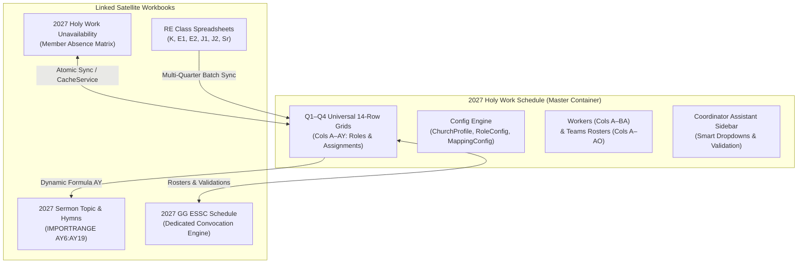

# Holy Work Schedule (HWS) System

> **Architecture:** Google Apps Script (V8 Runtime) + Multi-Church Cloud Engine  
> **Target Release:** `v2027.10.0` (Production Hardened & Audited)  
> **Deployment Tooling:** Google Clasp (`.clasp.json`) + Git / GitHub  
> **Master Calendar Standard:** Universal 14-Row Architecture (Rows 1–94, Columns A–AY)

The **Holy Work Schedule (HWS)** system is an enterprise-grade scheduling, validation, reminder, and synchronization platform built for True Jesus Church congregations. It synchronizes pastoral schedules, Religious Education (RE) classes, Southwestern Region (SWR) speaker rosters, and Evangelical Service and Spiritual Convocation (ESSC) assignments across multi-workbook ecosystems.

---

## 1. System Architecture & Workbooks

The ecosystem operates across four interconnected Google Sheets workbooks provisioned annually within the church's shared Google Drive folder:



### Core Workbooks
1. **`2027 Holy Work Schedule`** (`Master`): Central command workbook containing the Apps Script project container, coordinator sidebar, monthly generator, automated email triggers, and Universal 14-Row quarterly tabs (`Q1`–`Q4`).
2. **`2027 Holy Work Unavailability`**: Interactive matrix where members submit planned absences. Synchronized to the master workbook using atomic ScriptLock writes.
3. **`2027 Sermon Topic & Hymns`**: Regional speaker, sermon title, and hymn tracking workbook. Linked directly to master bilingual speaker lookup Column `AY`.
4. **`2027 GG ESSC Schedule`**: Dedicated scheduling engine for biannual spiritual convocations with isolated sidebar and validation logic.

---

## 2. Repository File Structure

```text
├── .clasp.json                                # Apps Script project deployment binding
├── .claspignore                               # Production filter preventing test file deployments
├── appsscript.json                            # Manifest with explicit OAuth permission scopes & America/Los_Angeles TZ
├── AppConfig.js                               # Global configuration constants, AppLogger, parseA1Coords_, Lock/Retry engine
├── Admin_Tools.js                             # Sidebar backend, Annual Rollover, Unavailability sync, Admin tools
├── GenerateMonthly.js                         # Monthly printout engine, Bible reading plan injector
├── Service_Reminders.js                       # Monday / Friday / Saturday automated HTML email reminders
├── ExportSchedulePDF.js                       # PDF export engine, Google Drive publisher, links archive
├── GenerateESSC.js                            # ESSC schedule generator and standalone sidebar
├── SyncRESchedules.js                         # Religious Education batch synchronization engine
├── SyncSWR.js                                 # Southwestern Region speaker import and normalization
├── Validation.js                              # Programmatic dropdown validation and rule compilation
├── Sidebar.html                               # Coordinator Scheduling Assistant sidebar frontend
├── SetupWizard.html                           # Multi-step annual rollover and setup UI
├── ARCHITECTURAL_AUDIT_REPORT_2027.md         # Standalone comprehensive 2027 code & architecture audit report
├── AUDIT_SUMMARY.md                           # Comprehensive technical audit log and remediation table
├── RELEASE_NOTES.md                           # Release changelog and version history
├── Admin_Guide.md                             # Technical administrator operations manual
├── Coordinator_Guide.md                       # Coordinator scheduling assistant user guide
└── Deployment_Guide.md                        # Step-by-step multi-church deployment guide
```

---

## 3. Universal 14-Row & 51-Column (`A`–`AY`) Layout

All quarterly tabs (`Q1`, `Q2`, `Q3`, `Q4`) standardize on a 51-column layout spanning rows 1 to 94:
- **Columns A–AC**: Pastoral services (Sermon, Interp, Presider, Pianist, Grace, Prayers, Ushers, AV, Nursery).
- **Columns AD–AR**: Friday & Saturday Cleaning Teams (Friday Chapel, Windows, Saturday Chapel & MPR, Trash, Restrooms).
- **Columns AS–AX**: Fellowships & Midweek Services (Joy Fellowship, Wed Evening Bible Study, South/West/North/Agape).
- **Column AY**: Bilingual Speaker Dynamic `XLOOKUP` (`=IF(ISBLANK(B6), "", IFERROR(XLOOKUP(B6, Workers!$E$3:$E971, Workers!$H$3:$H971, B6), B6))`).

---

## 4. Operational Quickstart

### Clasp & Git Pair Programming
To deploy updates from your local workspace:
```bash
# 1. Pull latest git commits and Apps Script changes
git pull origin main
clasp pull

# 2. Develop and verify scripts locally
npm run test:syntax # or node syntax check

# 3. Deploy to Google Apps Script container
clasp push

# 4. Commit and push to GitHub
git commit -am "feat: implement quarterly schedule updates"
git push origin main
```

### Running the Live One-Time Remediation Utility
After deploying code to `2027 Holy Work Schedule`, open **⛪ Holy Work Admin > 🛠️ System Setup & Maintenance > 🩺 Run 2027 Live Sheet Repair** (`repair2027LiveSpreadsheets()`) to automatically:
1. Re-link `2027 Sermon Topic & Hymns` `IMPORTRANGE` formulas from Column `BB` to Column `AY` across `Q1`–`Q4`.
2. Update `Team Emails` and `Usher Team Emails` `FILTER` ranges from Row 4 to Row 3 (including worker `Aaron Young`).
3. Set `2027 GG ESSC Schedule` spreadsheet timezone to `America/Los_Angeles`.
4. Deduplicate `Coordinators` rows and normalize `PublishedLinks!A2` to plain text.
